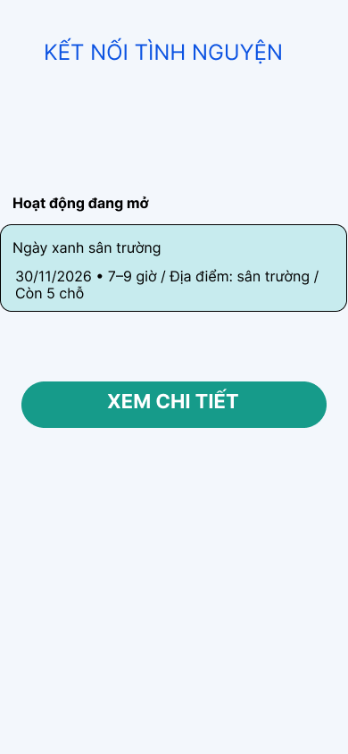

# Kết nối tình nguyện
**Tác giả:** MaHS

## Mục tiêu
Bản mẫu ứng dụng xem hoạt động tình nguyện và thử đăng ký.

## Liên kết
- [Tệp thiết kế Figma](DAN_LINK_TEP)
- [Prototype tương tác](DAN_LINK_PROTOTYPE)

## Cách dùng
1. Bấm **Xem chi tiết** ở màn Danh sách.
2. Bấm **Đăng ký thử** ở màn Chi tiết.
3. Bấm **Về danh sách** để bắt đầu lại.
4. Thử nút **Quay lại** tại màn Chi tiết.

## Ảnh màn hình

